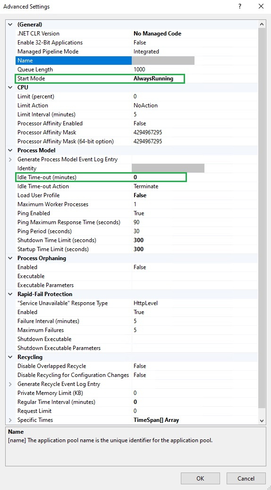

# Keeping the API application always running

By default, IIS starts the SPS+ back-end application only when the first request arrives and
stops it after 20 minutes without visitors. This preserves energy and memory on the server, but the
first user after a server restart, an application pool recycle, or a period of inactivity has to
wait for the full application startup, which may take a long time. The optional instructions on
this page make the application start automatically and stay running, so users never experience the
slow first request.

> These settings increase the use of energy and memory on the server, because the application stays
loaded even when no one is using it. If you prefer to preserve server resources, skip this page and
keep the default behavior.

> Before you begin, make sure the recommended application pool parameters from
[Setting up IIS websites for the first time](./setting-up-iis-websites-for-the-first-time.md) are
already applied, in particular disabling the Regular Time Interval recycling.

## Enable automatic startup and warmup

First, install the *Application Initialization* feature of IIS, if it is not installed already. Open
Server Manager, choose Add Roles and Features, and under Web Server (IIS) > Web Server >
Application Development, check *Application Initialization*. Alternatively, run the following
command in an elevated PowerShell:

```powershell
Install-WindowsFeature Web-AppInit
```

Then, in IIS Manager, find the Application Pool with the same name as the API website - usually
SPS Plus - API. It is located in the tree on the left under Application Pools. Right-click on it
and choose Advanced Settings. In the modal popup, set:

- **Start Mode**: *AlwaysRunning* — IIS starts the application immediately after a recycle or a
server restart, instead of waiting for the first request.
- **Idle Time-out (minutes)**: *0* — prevents the application from shutting down due to inactivity.



Finally, enable warmup on the API website itself. In the tree on the left, select the *SPS Plus - API*
website, click Advanced Settings in the Actions pane on the right, and set **Preload Enabled** to
*True*. With this setting, whenever the application pool starts, IIS immediately sends a warmup
request to the application, so the slow initialization happens in the background instead of on the
first user request.

To verify the setup, restart the application pool without opening the website, wait about a minute,
then open the website — it should load within a few seconds. You can also check in Task Manager that
a *w3wp.exe* process for the API application pool is running even though no one has accessed the site.

> A lighter middle ground: instead of setting the Idle Time-out to 0, set **Idle Time-out Action**
to *Suspend*. The application is swapped out of memory after 20 idle minutes, but resumes in a few
seconds instead of performing a full startup. Use this if memory on the server is limited.

## Alternative: warmup script with a scheduled task

The settings above make Windows start all *AlwaysRunning* applications at the same time when the
server boots. If the server hosts several SPS+ instances (or other heavy applications), the
simultaneous startups compete for CPU and database connections, each one takes much longer than
usual, and they can exceed the startup time limit and end up restarting in a loop. In that case,
use a warmup script instead: it starts the applications strictly one at a time, waiting for each
one to finish initializing before starting the next.

For this approach, leave **Start Mode** at *OnDemand* and only set **Idle Time-out (minutes)** to
*0* on each API application pool - once started, the application never stops, and the script below
is what starts it.

Save the following script, for example as *C:\Scripts\Warm-SpsApi.ps1*. It is written for a single
API website called *SPS Plus - API*; if the server hosts more instances, add their website names to
the `$warmSites` list and they will be warmed up one at a time, in order.

```powershell
# Warm-SpsApi.ps1 - starts the SPS Plus API applications one at a time, if not already running.
$warmSites = @(
    'SPS Plus - API'
)
$log = 'C:\Scripts\sps-warmup.log'
Import-Module WebAdministration
[System.Net.ServicePointManager]::ServerCertificateValidationCallback = { $true }

function Write-Log($msg) {
    Add-Content -Path $log -Value ("{0}  {1}" -f (Get-Date -Format 'yyyy-MM-dd HH:mm:ss'), $msg)
}

foreach ($siteName in $warmSites) {
    $site = Get-Website -Name $siteName
    if (-not $site) { Write-Log "SKIP $siteName - site not found"; continue }
    if ($site.State -ne 'Started') { Write-Log "SKIP $siteName - site is $($site.State)"; continue }

    # Build the local URL of the website from its first binding.
    $b = $site.Bindings.Collection | Select-Object -First 1
    $parts = $b.bindingInformation -split ':'
    $ip = $parts[0]; $port = $parts[1]; $hostHeader = $parts[2]
    $target = if ($ip -and $ip -ne '*') { $ip } else { 'localhost' }
    $url = '{0}://{1}:{2}/' -f $b.protocol, $target, $port

    try {
        $req = [System.Net.WebRequest]::CreateHttp($url)
        if ($hostHeader) { $req.Host = $hostHeader }
        $req.Timeout = 300000
        $req.ReadWriteTimeout = 300000
        $sw = [System.Diagnostics.Stopwatch]::StartNew()
        $resp = $req.GetResponse()
        $resp.Close()
        Write-Log ("OK   {0} in {1:n1}s" -f $siteName, $sw.Elapsed.TotalSeconds)
    } catch [System.Net.WebException] {
        if ($_.Exception.Response) {
            # An HTTP error response still means the application has started.
            Write-Log ("OK   {0} responded HTTP {1} (app is up)" -f $siteName, [int]$_.Exception.Response.StatusCode)
        } else {
            Write-Log ("FAIL {0} - {1}" -f $siteName, $_.Exception.Message)
        }
    } catch {
        Write-Log ("FAIL {0} - {1}" -f $siteName, $_.Exception.Message)
    }
}
```

Then register a scheduled task that runs the script when the server starts (with a short delay, so
IIS and SQL Server have settled) and once an hour as a safety net, in case someone recycles the
application pool manually. Run the following in an elevated PowerShell:

```powershell
$action = New-ScheduledTaskAction -Execute 'powershell.exe' `
    -Argument '-NoProfile -ExecutionPolicy Bypass -File "C:\Scripts\Warm-SpsApi.ps1"'
$boot = New-ScheduledTaskTrigger -AtStartup
$boot.Delay = 'PT2M'
$hourly = New-ScheduledTaskTrigger -Once -At (Get-Date).AddMinutes(5) -RepetitionInterval (New-TimeSpan -Hours 1)
$principal = New-ScheduledTaskPrincipal -UserId 'SYSTEM' -LogonType ServiceAccount -RunLevel Highest
$settings = New-ScheduledTaskSettingsSet -ExecutionTimeLimit (New-TimeSpan -Hours 1) -StartWhenAvailable
Register-ScheduledTask -TaskName 'SPS API Warmup' -Action $action -Trigger $boot, $hourly -Principal $principal -Settings $settings
```

> If Register-ScheduledTask reports an error about the repetition settings on your version of
Windows Server, add `-RepetitionDuration ([TimeSpan]::MaxValue)` to the `$hourly` line.

To verify, run the script once by hand and check the log file:

```powershell
powershell -NoProfile -ExecutionPolicy Bypass -File C:\Scripts\Warm-SpsApi.ps1
Get-Content C:\Scripts\sps-warmup.log
```

Each website should log an `OK` line with its startup time. After a server restart, the log shows
the applications being warmed up in order, and the first visitor no longer waits for the startup.

___

[Home](../README.md) / Back: [Setting up IIS websites for the first time](./setting-up-iis-websites-for-the-first-time.md)
